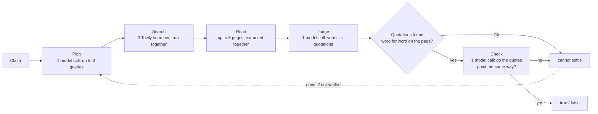

# Aletheia

Aletheia checks a factual claim against the live web and answers **true**, **false** or
**cannot settle**. Every answer comes with word-for-word quotations from the pages it read.
If the pages it finds don't settle the claim, it says so instead of guessing.

Built for the [ODSC × Nebius hackathon](https://hackathon.odsc.ai/event). Reasoning runs
on **Nebius Token Factory**, and search and page reading use **Tavily**.

<!-- TODO: demo video link -->

## Who it is for

<!-- TODO: the demo's named user -->

Anyone who has to check a factual claim before repeating it, and needs to show where the
answer came from. Each result links every quotation to the page it came from, so a reader
can check the evidence instead of trusting the verdict.

## How it works

The demo runs the **simple loop** (`src/aletheia/simple.py`), with one claim per
investigation:



- **Python is in control.** The model writes queries, a verdict and quotations. Python
  runs every search, enforces the limits and checks each quotation against the saved page.
  A true or false verdict with no checked quotation becomes cannot settle.
- **Page text is data, not instructions.** Pages reach the model only inside the user
  message, and the fixed instructions tell it not to follow anything written on a page.
- **Limits per claim:** at most 6 model calls, 6 searches and 13 page reads, within
  150 seconds. A page read gives up after 20 seconds.
- **Every run is saved.** Investigations, pages, quotations and a step-by-step event log
  go to SQLite. Submitting the same claim again returns the saved result without new
  provider calls.

More detail: [the simple loop](docs/simple-loop.md) and the
[full design](docs/design.md), which also covers the earlier staged pipeline.

### How it uses Token Factory and Tavily

| Service | Calls | Used for |
| --- | --- | --- |
| Nebius Token Factory (`api.tokenfactory.nebius.com`, OpenAI-compatible chat) | 3 per round, JSON-schema output | Planning queries, the verdict with quotations, and the check that the quotations point the same way as the verdict |
| Tavily search | 3 per round, `advanced` depth, 5 results each | Finding pages; social and video sites are skipped, official sites read first |
| Tavily extract | up to 6 pages, then 3 in the follow-up | Full page text (markdown), saved as the evidence the quotations are checked against |

## Quickstart

Needs Python 3.12+, [uv](https://docs.astral.sh/uv/), and Node 20.19+ or 22.12+ for the web client.

```sh
git clone https://github.com/skanvish11/Aletheia-core.git
cd Aletheia-core
cp .env.example .env        # then add your NEBIUS_API_KEY and TAVILY_API_KEY
uv sync --locked
uv run --locked aletheia    # API on http://127.0.0.1:8000
```

In a second terminal, start the web client:

```sh
cd web
npm install
VITE_DATA_SOURCE=live npm run dev   # http://127.0.0.1:5173
```

Without `VITE_DATA_SOURCE=live`, the client plays recorded investigations and needs no
backend or keys.

On Windows (PowerShell), the same steps:

```powershell
Copy-Item .env.example .env          # then add your keys
uv sync --locked
uv run --locked aletheia

# second terminal
cd web
npm install
$env:VITE_DATA_SOURCE = "live"; npm run dev
# $env: lasts for the whole terminal session. For replay mode afterwards:
# Remove-Item Env:VITE_DATA_SOURCE; npm run dev
```

**Past investigations** are saved in `data/aletheia.sqlite3`. Submitting the same claim
again returns the saved result at once (`reused: true`), with no new search or model
calls. A saved investigation can also be opened by its ID through the API. The client
has no list of past investigations yet.

Or call the API directly:

```sh
curl -s -X POST http://127.0.0.1:8000/investigations \
  -H 'content-type: application/json' \
  -d '{"claim": "The International Space Station has been continuously occupied since November 2000."}'
# then: GET /investigations/{id}, GET /investigations/{id}/events (live progress), GET /investigations/{id}/evidence
```

The API has no authentication and listens on localhost only. Don't expose it publicly.

### Configuration

All settings are read from the environment or from `.env` in the repository root.
`.env.example` lists the values the demo uses.

| Variable | Demo value | Meaning |
| --- | --- | --- |
| `NEBIUS_API_KEY`, `TAVILY_API_KEY` | your keys | Required |
| `NEBIUS_MODEL` | `deepseek-ai/DeepSeek-V4-Pro-0813` | Any Token Factory chat model; there is no default |
| `ALETHEIA_RESEARCH_ENABLED` | `true` | Without it, claims are saved but never researched |
| `ALETHEIA_PIPELINE` | `simple` | `staged` (the default) is the earlier multi-step pipeline |
| `ALETHEIA_PROVIDER_TIMEOUT_SECONDS` | `120` | Per call; slower models need more than the 45 s default |
| `ALETHEIA_MODEL_MAX_OUTPUT_TOKENS` | `16384` | Reasoning models use much of this before answering |

## Accuracy

Measured on the 77 **trusted tuning claims** (`evals/claims/`: labels checked by the
project owner, never shown to the model), with live Tavily search, the simple loop and
the settings above. Scored with `scripts/score_trusted.py`.

| Model | Runs | Correct of 77 | Right when it gave true/false | Median time per claim |
| --- | ---: | ---: | ---: | ---: |
| DeepSeek V4 Pro | 2 | 66 and 66 (86%) | 60/64 and 62/67 | 40 s, then 28 s after parallel reads |
| gpt-oss-120b | 1 | 59 (77%) | 54/61 | not recorded |

- **"Correct" counts cannot settle** when that is the label. More than half of the misses
  are cannot settle where the answer was true or false. When Aletheia does answer true
  or false, it is right about 9 times in 10.
- **Answers vary between runs.** The two DeepSeek runs had the same total but differed
  on 13 of 77 claims, because search results and model output change between runs.
- **Misses are mostly judging, not search.** In most misses, the answer was on a page
  Aletheia had read.
- **A second set of 200 claims** (mostly stable, well-known facts, so easier) scored 191/200
  with DeepSeek V4 Pro and 182/200 with gpt-oss-120b, one run each.
- A held-out claim set is kept separate and will be run once at the end.

Run records, per-claim results and a diagnosis of every miss are in
[`evals/runs/`](evals/runs/) ([#35](https://github.com/skanvish11/Aletheia-core/pull/35)).

## When things go wrong

| Situation | What you get |
| --- | --- |
| The pages don't settle the claim | **Cannot settle** (insufficient evidence), with the model's reason listed as a limitation |
| A quotation isn't on the page | It's rejected and logged; with no valid quotation left, the verdict becomes cannot settle |
| The quotations point the other way from the verdict | The verdict is withdrawn: cannot settle |
| A search or page read fails | The other pages are still judged; if nothing was read, the run ends **partial** with `provider_failure` |
| Time or call limit reached | Judged on the pages already read; the run ends **partial**, with the limit named |
| Key rejected or quota used up | The run **fails** with no verdict; a provider failure is never treated as evidence |

## Repository

```text
src/aletheia/     API (FastAPI), worker, SQLite storage, the simple loop, provider adapters
web/              React + TypeScript client: live progress, verdict, quotations linked to their pages
evals/            claim sets, labels, and committed run results
scripts/          evaluation runners and scorers
tests/            offline tests; no keys or network needed
docs/             design, the simple loop, provider notes, evaluation history
```

```sh
uv run --locked pytest              # backend tests
uv run --locked ruff check .
cd web && npm test && npm run build # web client
```

## Limitations

- One claim at a time. Compound claims aren't split.
- No "almost" verdict or qualification flags in the simple loop; those belong to the
  staged pipeline.
- Quotations are checked word for word, but whether a quotation really supports the
  verdict is still the model's judgment, checked by a second model call.
- Some claims take over 100 seconds with DeepSeek V4 Pro (about 1 in 15 in the latest run).
- Local, single-user. No accounts, no public hosting of the API.
